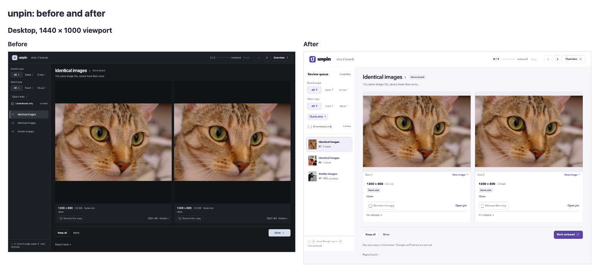
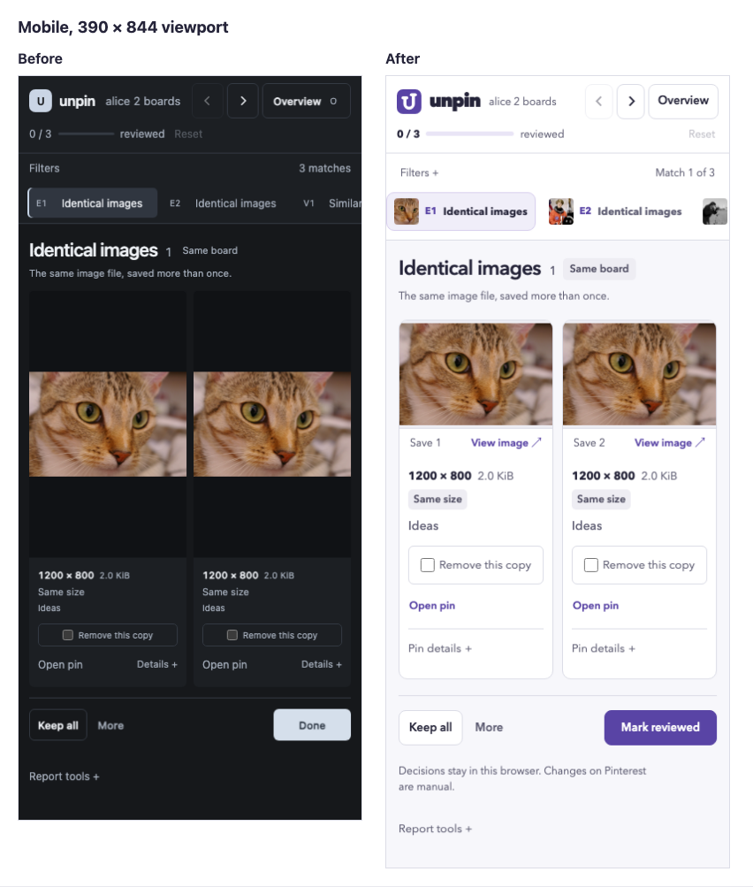

# Report UI review

The comparison captures show the report at `d6dbef1` and the redesigned report
on this branch. Both use the same synthetic scan and offline photographs from
`tests/fixtures/matching`. No Pinterest account was scanned or changed.





Desktop captures use a 1440 × 1000 viewport and mobile captures use 390 × 844.
These are full-page screenshots, so their document height can exceed the
viewport. The capture script also covers tablet and 320px layouts, selection,
expanded details, additional saves, empty results, cover-only matches,
completion, and keyboard focus.

The [SVG icon](../../../templates/icon.svg) combines two offset pin heads into
a “u.” The header includes this source directly, and the favicon embeds the
same source as a data URI. Reports need no separate icon file or network
request.


Five independent screenshot-review rounds preceded the final icon update.
Each reviewer received the same requirements, screenshots, and supplied
reference designs and worked read-only. Final overall scores were:

| Reviewer | Overall | Every category at least 9 in rounds 4 and 5 |
| --- | ---: | --- |
| GPT-6.1 Sol | 9.1 | Yes |
| GPT-6 Astra | 9.1 | Yes |
| GPT-6.1 Terra | 8.7 | No |

The [full scores](review-scores.json) retain all eight categories from the
baseline and five rounds. Scores are subjective. The unanimous 9/10 target
was not reached; the review stopped at its five-round limit. Remaining
low-severity observations concern sideways comparison on narrow screens,
vertical travel between phone images and review actions, and using focus view
for closer inspection than the compact overview provides. Real-device use
should guide any further layout changes.

The final icon was checked at 16, 32, 64, and 256px. Its favicon data URI was
decoded and compared with the SVG source, then rendered at 16px.

Validation after the icon update:

- 27 browser tests passed, including responsive layouts, keyboard review,
  image inspection, decision persistence, import/export, feedback placement,
  and sampled Axe WCAG A/AA checks.
- 181 Rust tests passed; four manual benchmarks were ignored.
- Rust formatting, Clippy with warnings denied, and diff whitespace checks
  passed.

Reproduce screenshots from the repository root:

```console
bun install --frozen-lockfile
bunx playwright install chromium
node tests/browser/capture-ui-review.mjs test-results/ui-review/current
```

The script captures the current code; the original baseline is preserved in
the comparison images above. Browser-test output is isolated under
`test-results/browser/` so running tests retains UI review captures.
