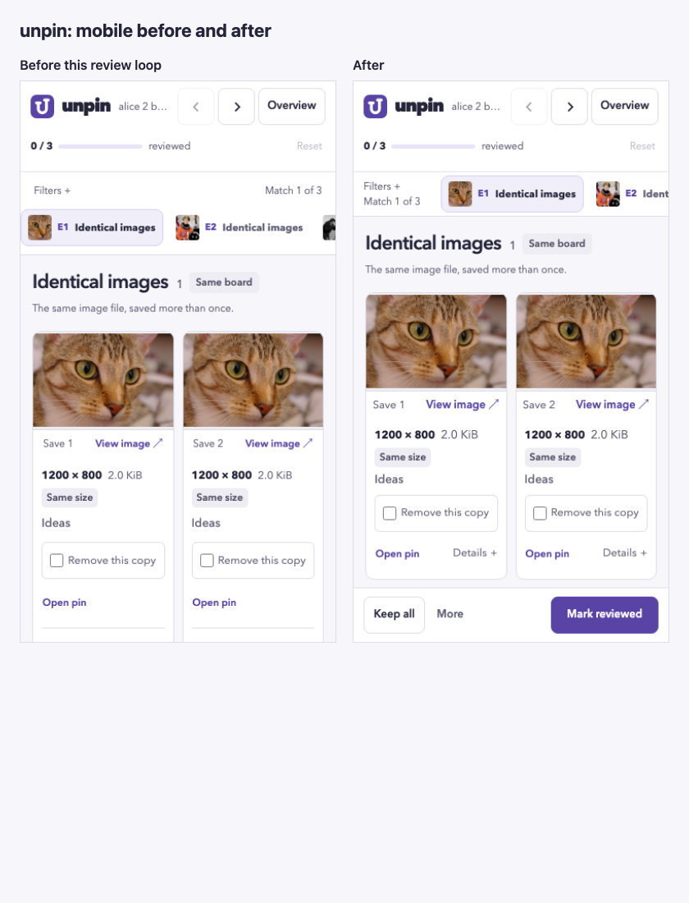
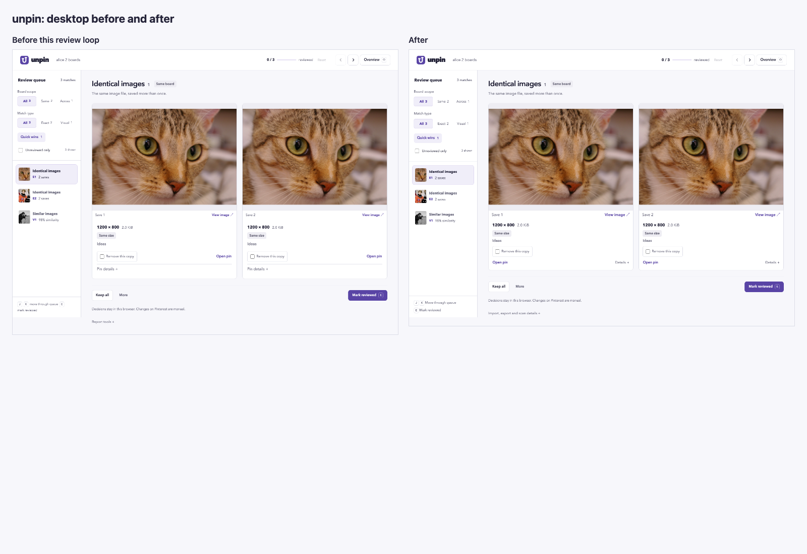

# Fresh Sol review loop

This follow-up starts at PR commit `ba08fcc`. Three new, independent GPT-6.1
Sol agents reviewed the same screenshots and three original references. They
had no inherited chat history or earlier review scores. Preliminary ratings
from reused reviewers were excluded when the user requested fresh agents.

All three reviewers scored every category at least 9/10 in rounds four and
five, with no remaining findings. The two-consecutive-round target was met
within the five-round limit.






The captures run the actual Rust-generated report using the same synthetic
scan and offline photographs. The comparison's before state is the start of
this loop, not the original dark interface. Twenty-one full-document states
and four viewport-only screenshots cover desktop, tablet, narrow layouts,
375×667 phones, 844×390 landscape, 1280×720 desktops, expanded details,
selection, completion and focus. Viewport captures establish what is initially
visible; full-document screenshots can extend beyond the physical viewport.
The references were inspected as images; GIF animation was not assessed.

Changes made:

- Combined Open pin and Details in a stable compact footer, with expanded
  metadata below it. Shortened the selected label to prevent card-height shifts.
- Kept review/save actions available on short screens, with a single-row
  landscape action bar and content clearance for scrolling and keyboard focus.
- Condensed short-screen navigation and bounded the desktop queue above its
  keyboard help. Kept image sizes useful while allowing complete card footers
  to clear the decision bar.
- Exposed export at completion, named import/export in the tools disclosure,
  and kept external pin actions consistently labeled.
- Adjusted small supporting text, then corrected a caption-wrapping regression
  found during round three. Round five made no product changes and checked
  the final result again.

Scores are subjective visual judgments. Read-only reviews do not prove
universal accessibility or usability. Full category results are retained in
[review-scores.json](review-scores.json). Reviewer A, B and C are separate
instances of the same GPT-6.1 Sol model, as requested, rather than a panel of
different model families.

Final validation passed: 29 browser tests, 181 Rust tests (four manual
benchmarks ignored), Rust formatting, Clippy with warnings denied, and diff
whitespace checks. Browser coverage includes sampled Axe A/AA checks, short
screen action visibility, keyboard hit-testing against fixed chrome,
selection geometry, completion export, persistence, import/export, printing,
and expanded details.

Scrolling remains appropriate for long groups and expanded filters. Close
visual inspection remains available through View image. Physical-device and
assistive-technology user testing were not performed. Further cosmetic work
should be driven by observed use rather than rating targets.

Reproduce the current captures with:

```console
node tests/browser/capture-ui-review.mjs test-results/ui-review-rerun/current
```

Use `--reuse-html` only to recapture an existing Rust-rendered baseline without
rebuilding its templates. The capture script resets vertical scroll before
full-page shots and separately records relevant on-screen viewport states.

| Round | Sol reviewer | Hierarchy | Type | Spacing | Contrast | Consistency | Usability | Responsive | Overall |
| --- | --- | ---: | ---: | ---: | ---: | ---: | ---: | ---: | ---: |
| Baseline | A | 8.6 | 8.6 | 8.3 | 8.8 | 8.9 | 8.2 | 7.9 | 8.4 |
| Baseline | B | 8.6 | 8.7 | 8.3 | 9.0 | 8.8 | 8.3 | 7.9 | 8.5 |
| Baseline | C | 8.7 | 8.7 | 8.5 | 9.1 | 9.1 | 8.4 | 8.2 | 8.6 |
| Round 1 | A | 8.9 | 8.7 | 8.8 | 8.9 | 9.1 | 8.8 | 8.5 | 8.8 |
| Round 1 | B | 9.0 | 9.0 | 8.8 | 9.0 | 9.1 | 8.9 | 8.6 | 8.9 |
| Round 1 | C | 9.0 | 9.0 | 8.9 | 9.1 | 9.2 | 8.9 | 8.7 | 8.9 |
| Round 2 | A | 9.0 | 8.8 | 9.0 | 9.0 | 9.2 | 9.0 | 8.8 | 9.0 |
| Round 2 | B | 9.1 | 9.0 | 9.0 | 9.0 | 9.1 | 9.0 | 9.0 | 9.0 |
| Round 2 | C | 9.0 | 9.0 | 9.0 | 9.1 | 9.2 | 9.0 | 9.0 | 9.0 |
| Round 3 | A | 9.0 | 8.8 | 9.0 | 9.0 | 9.2 | 9.0 | 8.9 | 9.0 |
| Round 3 | B | 9.1 | 8.8 | 8.9 | 9.0 | 9.0 | 9.1 | 8.9 | 8.9 |
| Round 3 | C | 9.0 | 8.8 | 8.9 | 9.1 | 9.1 | 9.1 | 8.9 | 8.9 |
| Round 4 | A | 9.0 | 9.0 | 9.0 | 9.0 | 9.2 | 9.0 | 9.0 | 9.1 |
| Round 4 | B | 9.1 | 9.0 | 9.0 | 9.0 | 9.1 | 9.1 | 9.0 | 9.1 |
| Round 4 | C | 9.0 | 9.1 | 9.1 | 9.1 | 9.2 | 9.1 | 9.1 | 9.1 |
| Round 5 | A | 9.0 | 9.0 | 9.0 | 9.0 | 9.2 | 9.0 | 9.0 | 9.1 |
| Round 5 | B | 9.1 | 9.0 | 9.0 | 9.0 | 9.1 | 9.1 | 9.0 | 9.1 |
| Round 5 | C | 9.0 | 9.1 | 9.1 | 9.1 | 9.2 | 9.1 | 9.1 | 9.1 |
